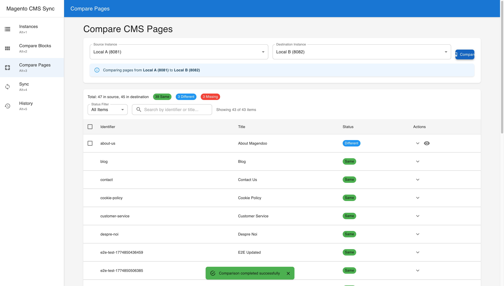
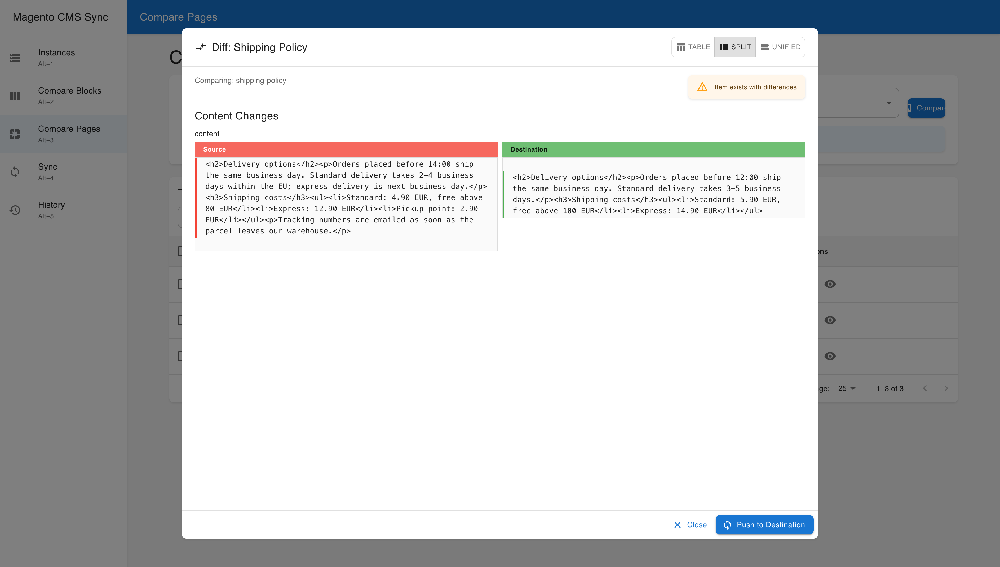

# Magento CMS Sync

A powerful web-based tool for synchronizing CMS content (blocks and pages) between multiple Magento 2 instances. Built with FastAPI (Python) backend and React (TypeScript) frontend.

## Features

- 🔄 **Bi-directional Sync**: Compare and sync CMS blocks and pages between Magento instances
- 📊 **Visual Comparison**: Side-by-side diff view with syntax highlighting
- 🎯 **Selective Sync**: Choose specific items to sync with granular control
- 📈 **Real-time Dashboard**: Monitor sync operations with live statistics
- 🔍 **Advanced Filtering**: Filter by status, type, date range, and more
- 📜 **Comprehensive History**: Track all sync operations with detailed logs
- 🔐 **Secure API Integration**: Connect to Magento instances using REST API tokens
- 🚀 **High Performance**: Asynchronous operations with background task processing



## Quick Start with Docker

```bash
# Clone the repository
git clone https://github.com/yourusername/magento-cms-sync.git
cd magento-cms-sync

# Start with Docker Compose
docker-compose up -d

# Access the application
# Frontend: http://localhost:3000
# Backend API: http://localhost:8000
# API Docs: http://localhost:8000/docs
```

## Manual Installation

### Prerequisites

- Python 3.11+
- Node.js 18+
- npm or yarn

### Backend Setup

```bash
cd backend

# Create virtual environment
python -m venv venv
source venv/bin/activate  # On Windows: venv\Scripts\activate

# Install dependencies
pip install -r requirements.txt

# Required: key used to encrypt Magento API tokens at rest (keep it with your backups)
export ENCRYPTION_KEY=$(python -c 'from cryptography.fernet import Fernet; print(Fernet.generate_key().decode())')

# Start the server (database tables are created on first start)
uvicorn main:app --reload --host 0.0.0.0 --port 8000
```

### Frontend Setup

```bash
cd frontend

# Install dependencies
npm install

# Start the development server
npm start
```

## Configuration

### Backend Environment Variables

Create a `.env` file in the backend directory:

```env
# Required: Fernet key for encrypting Magento API tokens at rest
ENCRYPTION_KEY=<generated key>

# Database (async driver required)
DATABASE_URL=sqlite+aiosqlite:///./cmssync.db

# CORS Origins (comma-separated)
CORS_ORIGINS=http://localhost:3000,http://localhost:3001
```

See `backend/.env.example` for every setting.

### Frontend Environment Variables

Create a `.env` file in the frontend directory:

```env
# API URL
REACT_APP_API_URL=http://localhost:8000

# Port (optional)
PORT=3000
```

## Usage Guide

### 1. Add Magento Instances

1. Navigate to the "Instances" page
2. Click "Add Instance"
3. Enter:
   - Instance name
   - Magento base URL (e.g., https://your-store.com)
   - REST API Integration token
4. Test the connection and save

### 2. Refresh Data

- Click the refresh icons to pull latest CMS content
- Data is cached locally for better performance
- Refresh on-demand when needed

### 3. Compare Content

1. Navigate to "Compare Blocks" or "Compare Pages"
2. Select source and destination instances
3. Click "Compare" to see differences
4. Use filters and search to find specific content

### 4. Sync Content

#### Individual Sync
1. Click the "View Diff" button on any item
2. Review the changes in the visual diff viewer
3. Click "Push to Destination" to sync that item



#### Bulk Sync
1. Select multiple items using checkboxes
2. Click "Sync X items"
3. Review the preview
4. Confirm to execute the sync

### 5. Monitor Progress

- View active syncs in real-time on the Sync page
- Check sync history with detailed logs
- Export history to CSV for reporting

## API Documentation

The backend provides a comprehensive REST API. Access the interactive documentation at:
- Swagger UI: http://localhost:8000/docs
- ReDoc: http://localhost:8000/redoc

### Key Endpoints

- `GET /api/instances/` - List all instances
- `POST /api/instances/` - Add new instance
- `POST /api/compare/blocks` - Compare CMS blocks
- `POST /api/compare/pages` - Compare CMS pages
- `POST /api/sync/blocks` - Sync CMS blocks
- `POST /api/sync/pages` - Sync CMS pages
- `GET /api/history/` - Get sync history
- `GET /api/history/statistics` - Get sync statistics

## Architecture

### Backend (FastAPI)
- Asynchronous Python web framework
- SQLAlchemy for database ORM
- Pydantic for data validation
- Background tasks for sync operations
- JSON file storage for data caching

### Frontend (React)
- TypeScript for type safety
- Material-UI component library
- Zustand for state management
- Axios for API communication
- React Router for navigation

### Data Storage Strategy
- Configuration stored in SQLite database
- CMS content cached as JSON files
- Located in `backend/data/instances/{instance_id}/`
- On-demand refresh for optimal performance

## Development

### Project Structure

```
magento-cms-sync/
├── backend/
│   ├── api/              # API endpoints
│   ├── models/           # Database models
│   ├── services/         # Business logic
│   ├── integrations/     # Magento API client
│   ├── data/            # JSON data storage
│   └── main.py          # FastAPI application
├── frontend/
│   ├── src/
│   │   ├── components/   # Reusable components
│   │   ├── pages/       # Page components
│   │   ├── services/    # API services
│   │   ├── store/       # State management
│   │   └── types/       # TypeScript types
│   └── public/          # Static assets
├── docker-compose.yml   # Docker configuration
└── start-dev.sh        # Development startup script
```

### Running Tests

```bash
# Backend tests
cd backend
pytest

# Frontend tests
cd frontend
npm test
```

### Code Quality

```bash
# Backend
black .           # Format code
flake8           # Lint code
mypy .           # Type checking

# Frontend
npm run lint     # ESLint
npm run format   # Prettier
```

## Troubleshooting

### Common Issues

1. **Connection refused to Magento API**
   - Verify the Magento URL is accessible
   - Check if the API token has correct permissions
   - Ensure Magento REST API is enabled

2. **CORS errors in browser**
   - Update CORS_ORIGINS in backend .env
   - Restart the backend server

3. **Database errors**
   - Stop the backend, delete `cmssync.db` and start it again; the tables are recreated

4. **Sync failures**
   - Check Magento API token permissions
   - Verify network connectivity
   - Review error logs in sync history

## Security Considerations

- API tokens are stored encrypted in the database
- HTTPS recommended for production
- CORS configured for specific origins
- No direct database access from frontend
- All operations logged for audit trail

## Performance Tips

- Use data refresh strategically - not needed for every comparison
- Filter large datasets before syncing
- Monitor sync history for failed operations
- Clean up old sync logs periodically

## Contributing

1. Fork the repository
2. Create a feature branch: `git checkout -b feature/amazing-feature`
3. Commit your changes: `git commit -m 'Add amazing feature'`
4. Push to the branch: `git push origin feature/amazing-feature`
5. Open a Pull Request

## License

This project is licensed under the MIT License - see the [LICENSE](LICENSE) file for details.

## Acknowledgments

- Built with [FastAPI](https://fastapi.tiangolo.com/)
- UI powered by [React](https://reactjs.org/) and [Material-UI](https://mui.com/)
- Magento integration via [REST API](https://devdocs.magento.com/guides/v2.4/rest/bk-rest.html)