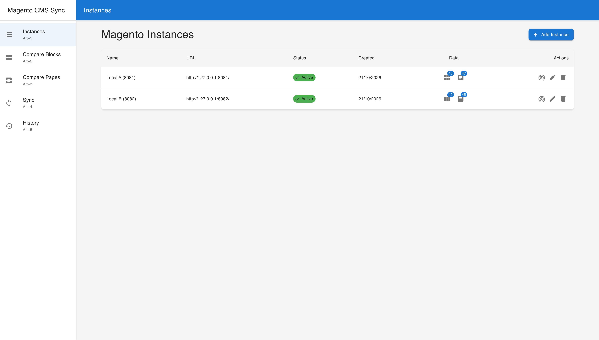
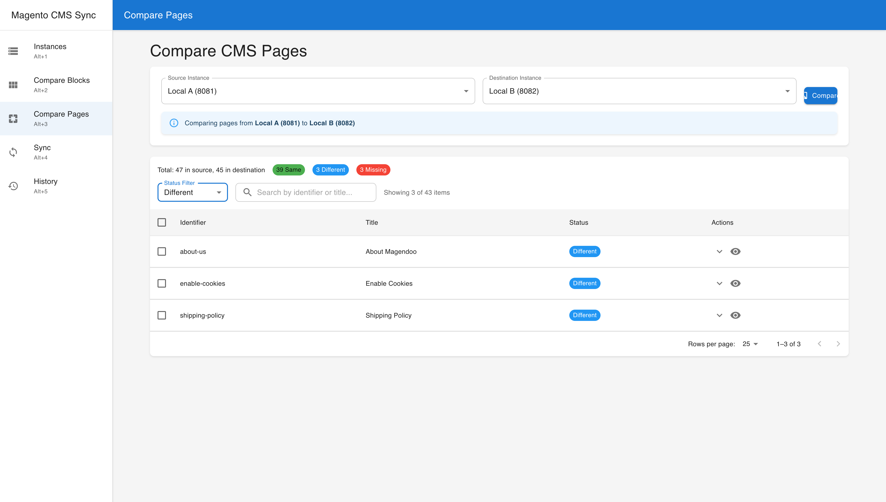
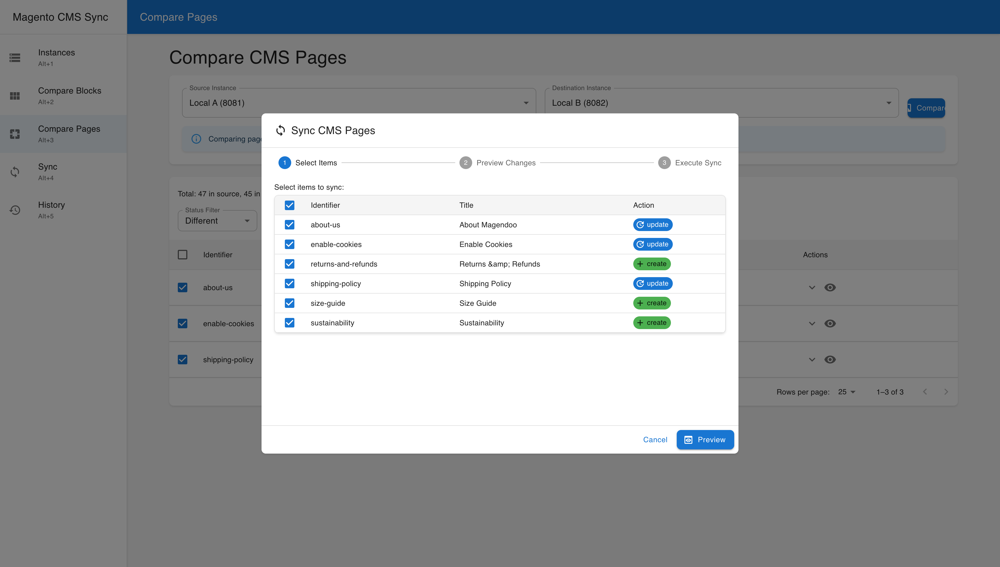
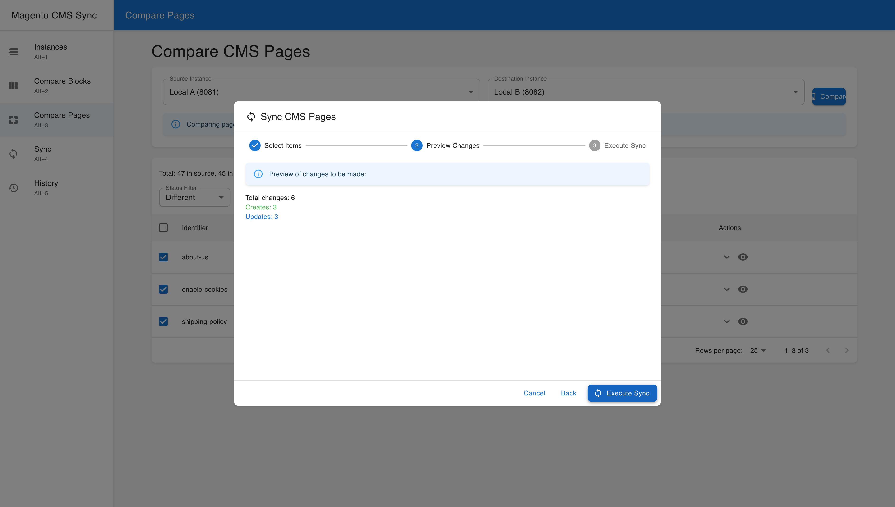
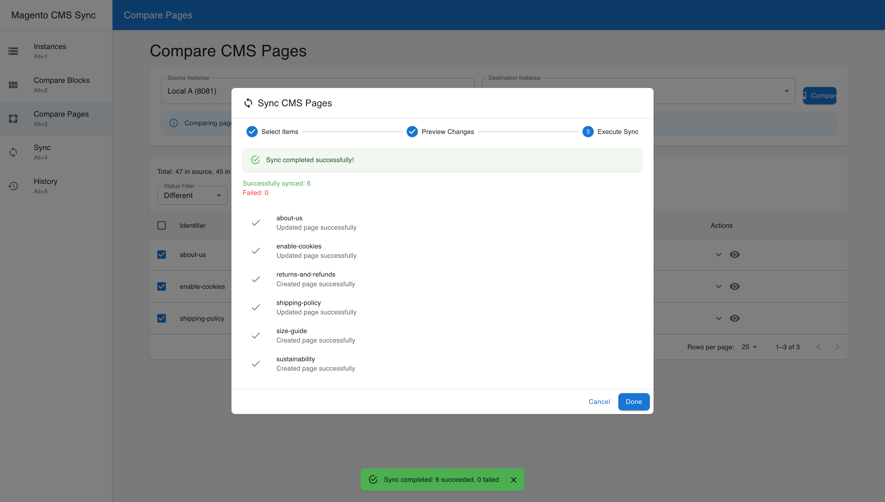
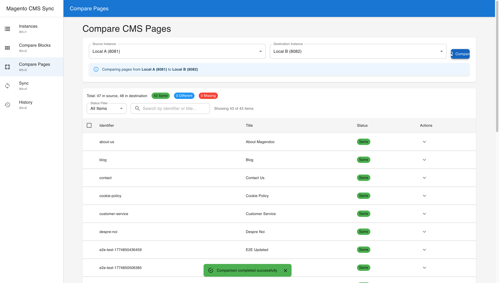
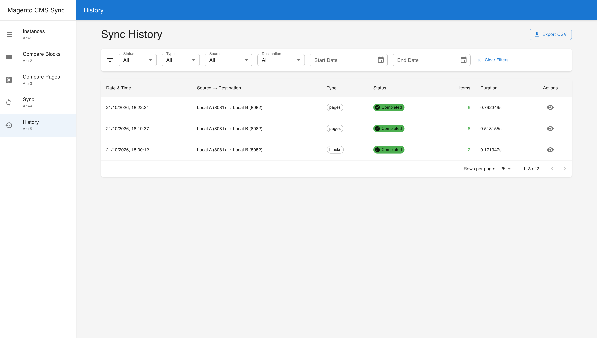

# Magento CMS Sync

**Compare and synchronise CMS blocks and pages between Magento 2 stores, from a browser.**

Magento CMS Sync connects to two or more Magento 2 instances through their REST API, caches
their CMS blocks and pages, shows what differs, and pushes the items you select from a
source store to a destination store. Typical uses: promoting content from staging to
production, keeping a group of stores aligned, or auditing drift between environments.


## Features

- **Instances**: register any number of Magento 2 stores with a REST token, test the
  connection, refresh their CMS content on demand and see how many items are cached.
- **Compare**: one row per block or page with its status (same, different, missing in
  destination, only in destination), a status filter and free-text search.
- **Diff viewer**: field-by-field table, or split and unified (word-level) diffs of the content.
- **Sync wizard**: pick items, preview how many creates and updates will happen, execute,
  and get a per-item result.
- **History**: every sync with status, counts, duration and per-item messages; CSV export.
- **Conservative by design**: a sync only creates or updates items in the destination. It
  never deletes anything and never writes to the source.

## Screenshots

Taken from the running UI against two real Magento 2.4.9 instances.

| | |
|---|---|
| **Instances** with cached block/page counts and connection test<br> | **Compare pages**, filtered to the items that differ<br> |
| **Diff viewer** (table, split or unified)<br> | **Sync wizard, step 1**: pick creates and updates<br> |
| **Sync wizard, step 2**: preview the changeset<br> | **Sync wizard, step 3**: per-item result<br> |
| **After the sync**: nothing left to do<br> | **History** with filters and CSV export<br> |

## How it works

1. **Snapshots.** Each instance's blocks and pages are fetched through the Magento REST API
   (`cmsBlock/search`, `cmsPage/search`, 100 items per request) and cached as JSON files on
   the server. Comparisons read these snapshots; refresh an instance to pull new content.
2. **Matching.** Items are matched across instances by their Magento `identifier` (the URL
   key of a page, the identifier of a block).
3. **What counts as different.** Blocks: title, content, active, sort order. Pages: title,
   content, content heading, page layout, meta title/keywords/description, active, sort
   order, layout update XML and the custom theme/template fields. Creation and update
   timestamps are not compared, because Magento sets them on each server.
4. **Sync.** Items missing in the destination are created; items that differ are updated in
   place using the destination's own id. The source copy comes from the cached snapshot; the
   destination is read live at sync time so ids are current. Afterwards the destination
   snapshot is refreshed automatically.

Details, including the exact Magento REST calls and permissions, are in
[docs/ARCHITECTURE.md](docs/ARCHITECTURE.md).

## Requirements

- One or more **Magento 2.4.x** stores whose REST API is reachable from the machine running
  this tool, each with a token granting `Magento_Cms::block`, `Magento_Cms::page`,
  `Magento_Cms::save` and `Magento_Backend::store` (see the
  [User Guide](docs/USER_GUIDE.md#before-you-start-a-magento-api-token)).
- To run the tool: **Docker** with Compose, or **Python 3.11+** and **Node.js 18+**.

## Quick start with Docker

```bash
git clone https://github.com/florinel-chis/magento2-cms-sync.git
cd magento2-cms-sync
docker compose up -d --build
```

- UI: http://localhost (nginx serves the built frontend and proxies `/api` to the backend)
- API and interactive docs: http://localhost:8000/docs
- Data (SQLite database and cached snapshots) lives in `./backend/data`

`docker-compose.prod.yml` is the same stack with a named volume instead of the bind mount
and the frontend port taken from `PORT`. See [docs/DEPLOYMENT.md](docs/DEPLOYMENT.md).

## Running without Docker

Backend (FastAPI). Tables are created on first start; there is no migration step.

```bash
cd backend
python3 -m venv venv && source venv/bin/activate
pip install -r requirements.txt
uvicorn main:app --host 0.0.0.0 --port 8000
```

Frontend (React) in development, with the dev server proxying `/api` to port 8000:

```bash
cd frontend
npm install
PORT=3001 npm start          # http://localhost:3001
```

For production, `npm run build` produces static files in `frontend/build`; serve them with
any web server that proxies `/api` to the backend (nginx example in
[docs/DEPLOYMENT.md](docs/DEPLOYMENT.md)).

## Configuration

The backend reads these environment variables (or a `backend/.env` file). Defaults in bold.

| Variable | Default | Purpose |
|---|---|---|
| `DATABASE_URL` | `sqlite+aiosqlite:///./cmssync.db` | SQLite database (async driver required) |
| `DATA_DIR` / `INSTANCES_DATA_DIR` | `data` / `data/instances` | Where snapshot JSON files are written |
| `CORS_ORIGINS` | `http://localhost:3000,http://localhost:3001` | Browser origins allowed to call the API directly |
| `MAGENTO_TIMEOUT` | `30` | Seconds per Magento request |
| `MAGENTO_RETRY_ATTEMPTS` / `MAGENTO_RETRY_DELAY` | `3` / `1` | Retries on 5xx or network errors, base delay in seconds |

The frontend reads only `REACT_APP_API_URL` (default `/api`); leave it unset unless the UI is
served from a different origin than the API. Full reference:
[docs/CONFIGURATION.md](docs/CONFIGURATION.md).

## Documentation

| Document | What it covers |
|---|---|
| [User Guide](docs/USER_GUIDE.md) | Magento token, every screen, the sync workflow, limitations |
| [Configuration](docs/CONFIGURATION.md) | Environment variables, file locations, logging |
| [Deployment](docs/DEPLOYMENT.md) | Docker Compose, manual install with nginx, backups, access control |
| [API Reference](docs/API.md) | Every REST endpoint with request and response shapes |
| [Architecture](docs/ARCHITECTURE.md) | Components, storage, comparison and sync rules, Magento REST usage |
| [Troubleshooting](docs/TROUBLESHOOTING.md) | Symptoms, causes and fixes |
| [Changelog](CHANGELOG.md) | What changed |
| [Contributing](CONTRIBUTING.md) | Development setup, conventions, tests, pull requests |
| [docs/README.md](docs/README.md) | Index of all documentation, including developer docs |

## Testing

The backend test suite runs the real application against a fake Magento REST API
(`backend/tests/magento_stub`), so no Magento installation is needed:

```bash
cd backend
pip install -r requirements-dev.txt
python -m pytest
```

The fake can also run as a standalone server for trying the UI without Magento
(`python -m tests.magento_stub --help`).

## Known limitations

- The application has **no authentication of its own**. Run it on a private network or
  behind a reverse proxy that requires login. Magento tokens are stored unencrypted in the
  SQLite database (the API never returns them).
- Items are matched by identifier only. Magento allows the same identifier once per store
  view; such duplicates collapse into a single row and may fail to sync.
- Store-view assignment is not synchronised. Stock Magento's REST API does not expose it;
  created items land on the destination's default (all store views).
- Deletions are never synchronised: items that exist only in the destination are reported,
  not removed.
- A sync runs inside the API process. If the backend restarts mid-sync, that run is recorded
  as failed at the next start and has to be repeated.

## License

MIT (see `LICENSE`).
