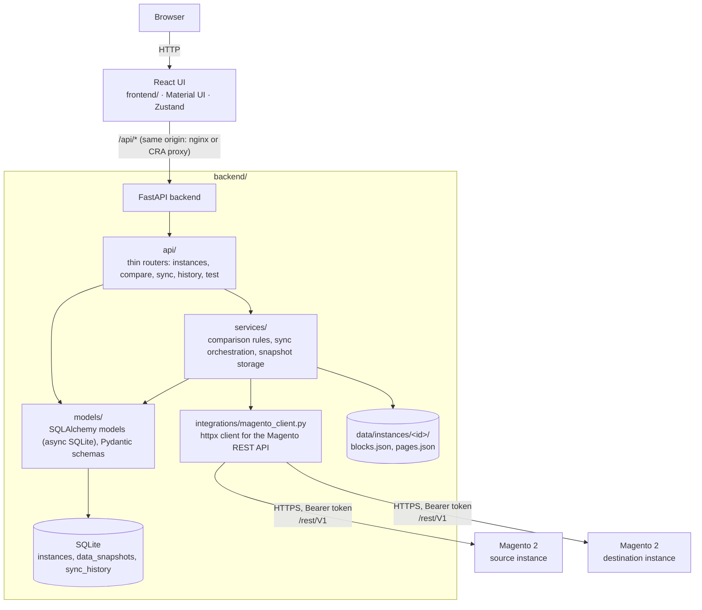
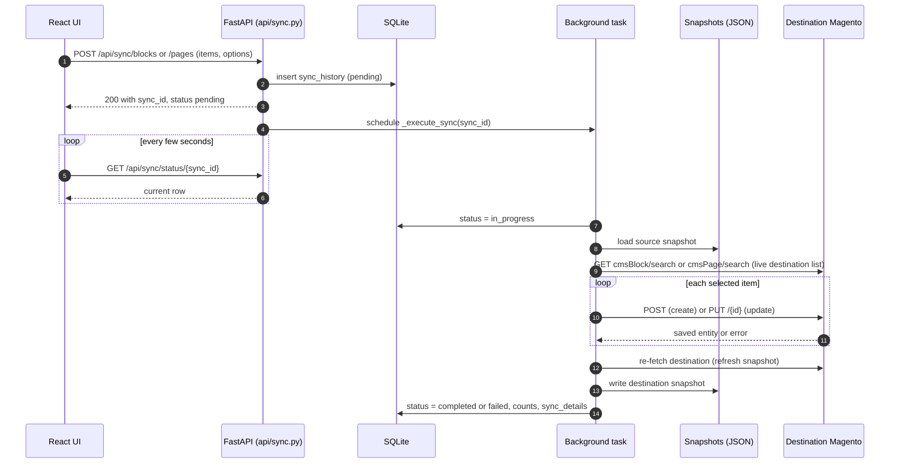

# Architecture

## Components

The backend is a single process. Syncs run as FastAPI background tasks inside it. At
startup, runs left `pending` or `in_progress` by a previous process are marked `failed`.

## Data flow

1. **Refresh** (`POST /api/compare/refresh/{id}`, the Data icons on the Instances page, or
   a first comparison without a snapshot): the Magento client pages through
   `cmsBlock/search` or `cmsPage/search` (100 items per page, until `total_count` is
   reached), fetches `store/storeViews`, writes the items to `blocks.json`/`pages.json` and
   records a `data_snapshots` row (item count, timestamp, store views as metadata).
2. **Compare**: both snapshots are loaded from disk and compared in memory; nothing is
   stored. The UI always compares with `force_refresh=false`.
3. **Diff**: the two snapshot items are compared field by field.
4. **Sync**: a `sync_history` row is created (`pending`), the request returns, and the
   background task runs the sync, updates the row (`in_progress` → `completed`/`failed`,
   counts, per-item results) and refreshes the destination snapshot.

### Sync sequence

## Storage

SQLite via SQLAlchemy's async engine (`aiosqlite`). Tables are created at startup with
`Base.metadata.create_all`; there are no migrations.

| Table | Purpose |
|---|---|
| `instances` | Name, URL, API token (encrypted), active flag |
| `data_snapshots` | One row per instance and content type: file path, item count, refresh time, store views |
| `sync_history` | One row per sync run: instances, type, status, counts, timestamps, error, `sync_details` JSON |

Snapshots are plain JSON arrays of the objects Magento returned, so they can be inspected
or diffed with ordinary tools.

## Comparison rules (`services/comparison.py`)

- Items are keyed by `identifier` (with `url_key` as a fallback for installs that expose it).
  Duplicate identifiers within one instance collapse to the last one read.
- Status per identifier: present on both sides and equal → `exists`; present on both sides
  and unequal → `different`; otherwise `missing` on the side that lacks it.
- Compared fields, blocks: `title`, `content`, `active`, `sort_order`. Pages: those plus
  `content_heading`, `page_layout`, `meta_title`, `meta_keywords`, `meta_description`,
  `layout_update_xml`, `custom_theme`, `custom_root_template`, `custom_layout_update_xml`.
  `store_id` is compared as a set when present. `creation_time`/`update_time` are ignored.
- `exists_in_both` in the result counts both `exists` and `different` items.

## Sync rules (`services/sync.py`)

- The source item is taken from the source **snapshot**; the destination list is fetched
  **live** at the start of the run so that ids are current.
- Payload: a copy of the source item minus `creation_time`, `update_time`, `created_at`,
  `updated_at`, and minus any id (`id`, `block_id`, `page_id`). For updates the destination's
  ids are set on the payload, because Magento saves whatever entity id the body carries. For
  creates no id is sent; Magento assigns one.
- With `fields_to_sync`, an update starts from the destination item and copies only the
  listed fields from the source.
- `store_view_mapping` rewrites `store_id` values when the item has them.
- Per-item errors (Magento rejections, missing source item, action/state mismatch) are
  recorded in `sync_details.results` and counted in `items_failed`; the run still ends
  `completed`. Errors that prevent the run (no source snapshot, destination unreachable)
  end it as `failed` with `error_message`.

## Magento REST usage

| Call | Purpose | ACL resource |
|---|---|---|
| `GET /rest/V1/store/storeViews` | Connection test; store views stored with snapshots | `Magento_Backend::store` |
| `GET /rest/V1/cmsBlock/search`, `GET /rest/V1/cmsPage/search` | Snapshot refresh (`searchCriteria[pageSize]=100`, `currentPage` paging) | `Magento_Cms::block`, `Magento_Cms::page` |
| `GET /rest/V1/cmsBlock/{id}`, `GET /rest/V1/cmsPage/{id}` | Available in the client, not used by the UI flows | same |
| `POST /rest/V1/cmsBlock`, `PUT /rest/V1/cmsBlock/{id}` | Create / update blocks | `Magento_Cms::block` |
| `POST /rest/V1/cmsPage`, `PUT /rest/V1/cmsPage/{id}` | Create / update pages | `Magento_Cms::save` |

Requests carry `Authorization: Bearer <token>`, time out after `MAGENTO_TIMEOUT` seconds and
are retried `MAGENTO_RETRY_ATTEMPTS` times on 5xx responses or network errors (never on 4xx).

Shapes returned by stock Magento 2.4: blocks `{id, identifier, title, content, creation_time,
update_time, active}`; pages add `page_layout, meta_title, meta_keywords, meta_description,
content_heading, sort_order, layout_update_xml, custom_theme, custom_root_template,
custom_layout_update_xml, custom_theme_from, custom_theme_to`. There is no `store_id`,
`is_active`, `url_key`, `block_id` or `page_id`, and Magento rejects unknown input properties.
The test suite's fake Magento (`backend/tests/magento_stub`) reproduces these rules.

## Security model

- The application itself has no users or authentication. Anyone who can reach the UI or
  the API can read tokens and write to the connected stores. Restrict network access or put
  a reverse proxy with authentication in front of it.
- Magento tokens are encrypted with Fernet (`ENCRYPTION_KEY`) before they are stored and
  decrypted in memory only when a Magento call is made. The API accepts tokens but never
  returns them. Rows written by versions before encryption are still accepted, with a
  warning in the log, until `scripts/encrypt_existing_tokens.py` has converted them.
- The backend talks to Magento with whatever the token allows; grant only the four ACL
  resources above.

## Known limitations

- Store-view assignment is not synchronised on stock Magento (not exposed by its API).
- Items with the same identifier in several store views collapse into one row.
- Deletions are never propagated.
- Comparisons read snapshots; stale snapshots give stale results.
- A backend restart abandons running syncs; they are recorded as failed at the next start
  and have to be repeated.
- The History page loads all runs (100 per request) and filters them in the browser.
